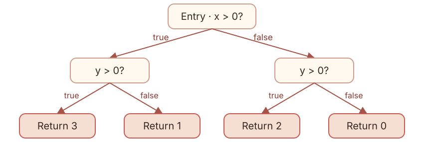
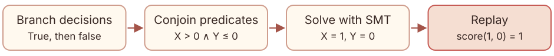
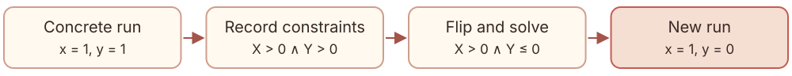

# Symbolic Execution

Classical symbolic execution aims at **systematic, exhaustive program exploration**. For test generation, the goal is to produce a concrete input for each feasible, terminating path.

## Execution trees

Assume a deterministic program whose **control flow depends only on its inputs**. Start at entry. Each branch occurrence splits a path according to its outcome. A leaf represents return or termination.



> Loops can revisit the same branch and produce an unbounded tree.

## Statement coverage can miss whole paths

```python
def score(x, y):
    points = 0
    if x > 0:
        points += 1
    if y > 0:
        points += 2
    return points
```

| Handwritten inputs | What they cover |
|---|---|
| `(1, 1)` and `(0, 0)` | Every executable statement and both outcomes of each branch |
| `(1, 0)` and `(0, 1)` | The two remaining paths, with mixed outcomes |

A coverage report can show **100% statement coverage** after the first two tests while path coverage is still **50%**.

## Replace inputs with symbols

Use integer symbols `X` and `Y` in place of concrete arguments. The interpreter tracks the next statement, a **symbolic store** mapping variables to symbolic expressions or values, and a **path condition** collecting constraints from the branches taken so far. These three components form the symbolic state.

- At entry, `points = 0` and the path condition is `true`.
- The first branch creates one state with `X > 0` and one with `X ≤ 0`.
- On the true side, `points` becomes `1`. On the false side, it stays `0`.
- If an instruction computes `z = x + 3`, the store records `z = X + 3`. A later test `z > 10` becomes `X + 3 > 10`.

Each symbolic state describes a set of concrete executions that have taken the same branches so far.

## Solve a path condition to get a test

For the path that takes **true** then **false**, conjoin the branch predicates.



| Path | Path condition | One test |
|---|---|---|
| True → True | `X > 0 ∧ Y > 0` | `(1, 1)` |
| True → False | `X > 0 ∧ Y ≤ 0` | `(1, 0)` |
| False → True | `X ≤ 0 ∧ Y > 0` | `(0, 1)` |
| False → False | `X ≤ 0 ∧ Y ≤ 0` | `(0, 0)` |

An **SMT solver** such as Z3 handles Boolean combinations of predicates over integers, bit vectors, and other theories. If a path requires both `X > 0` and `X < 0`, it is infeasible.

## Problem: Path explosion

With `n` independent binary branches there are **2ⁿ feasible paths**. At 20 branches that is **1,048,576** paths, each with only 20 branch decisions.

| Technique | Example | Core Insight |
|---|---|---|
| Heuristics | Favor a pending state near a statement the tests have yet to cover | Select "more important" paths under budgets, leaving other paths unexplored |
| Feasibility pruning | Discard the prefix `X > 0 ∧ X < 0` | Removes every descendant of an infeasible prefix |

## Problem: Execution modeling

An engine needs **rules for each instruction that can affect the path**. Those rules become more involved when a program uses shared objects or interacts with its environment.

| Operation | What a symbolic engine must account for |
|---|---|
| `y = x + 1` | Arithmetic semantics, including overflow where applicable |
| `a.f = x` then `y = b.f` | Whether `a` and `b` can refer to the same object |
| `read(fd, buf, n)` | File contents, errors, byte count, and changes to memory and file position |

## Concolic execution



Start with `(1, 1)`. Record `X > 0 ∧ Y > 0`. Preserve the first decision and flip the second. Solve `X > 0 ∧ Y ≤ 0` to get `(1, 0)`.

Normal execution handles concrete operations. Instrumentation tracks symbolic expressions and records branch constraints. Delegating an operation to concrete execution can simplify modeling. If the engine loses the result’s dependency on symbolic inputs at that boundary, it can miss alternative paths.

## Under-constrained symbolic execution

This technique **studies a piece of code under part of its context**.

Analyze a function in isolation. Start at its entry, make its arguments and any incoming state it reads symbolic, and apply the contracts users know. Then explore branches within the function.

```python
def first_item(items):
    assert len(items) > 0
    return items[0]
```

With an unconstrained list length `L ≥ 0`, symbolic execution finds `L = 0` as a candidate assertion failure. If every real caller guarantees a nonempty list, adding the entry constraint `L > 0` rules out that candidate.

Missing caller constraints can admit states that real executions never reach. Overly strong constraints or incomplete state models can also cause the analysis to miss real behaviors.

## Java PathFinder and Symbolic PathFinder

**Java PathFinder (JPF)** is an explicit-state model checker with a Java bytecode interpreter. It manages choices and backtracking over VM states.

**Symbolic PathFinder (SPF)** extends the interpreter with symbolic instruction semantics. It attaches symbolic attributes to values and uses path-condition choice generators to represent symbolic branch alternatives.

- **Peers** model library and native boundaries or delegate suitable work to the host JVM.
- **Listeners** observe execution. A listener can read path conditions from choice generators and associate branch constraints with bytecode locations.

**Missing runtime models** can prevent an application from starting under the symbolic interpreter.

## Knarr and COASTAL

Both instrument **Java bytecode** and execute it on a standard JVM. The concrete run decides which branches are taken.

| Engine | How it collects constraints |
|---|---|
| **Knarr** | Uses taint-tracking machinery to propagate symbolic expression tags alongside concrete values. After incrementing a value tagged `X`, its tag becomes `X + 1`. Instrumented branches record conditions on those expressions. |
| **COASTAL** | Uses instrumentation callbacks to mirror execution in symbolic state and record the path condition. Its test-generation framework combines concolic execution with fuzzing. |

A run can successfully cross into real libraries while losing symbolic information at an unsupported operation. The resulting path condition then provides less guidance for generating the next input.
